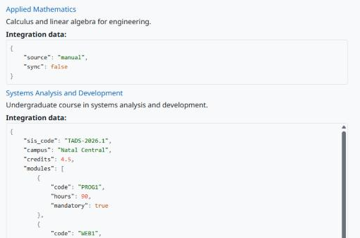

Usage
=====

Edit a document
---------------

On the edit form of a course, cohort, group or grouping, the JSON field opens the visual editor:

* **Tree:** expand objects and arrays, add, duplicate, move or remove items, and change the type of a value from the menu of each item.
* **Form:** edit only the values, keeping the structure.
* **Code:** edit the JSON as text with syntax highlighting, line numbers and buttons to format or compact it.
* **View:** read-only tree.

Every change is written to the form field. If the text is not valid JSON, a message under the editor shows the parser error, and the form refuses to save it until it is fixed.

A document that is not valid JSON opens in the code mode. Without JavaScript, or if the editor cannot start, the field is a plain monospaced textarea and the same server checks apply. A locked field is shown as text to users who cannot change it.

Display
-------

Where Moodle shows custom fields (for example the course listing, when the field is visible), the document is pretty-printed in a scrollable code block, with keys, strings, numbers, booleans and ``null`` in different colours. The content is always escaped: HTML inside strings is shown as text. A field without value shows its default value.

   The JSON field in the course listing.

Uploads and web services
------------------------

Course uploads and web services may save custom field values without running the form validation. The field checks these values too: a valid value is stored in canonical form, and an invalid one is ignored, keeping the stored value.
