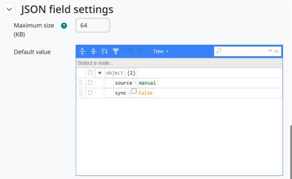

Configuração
============

Onde criar um campo JSON
------------------------

O tipo de campo **JSON** aparece em todas as áreas que usam os campos personalizados do Moodle. As principais:

* **Cursos:** *Administração do site > Cursos > Configurações padrão > Campos personalizados do curso*.
* **Coortes:** *Administração do site > Usuários > Contas > Campos personalizados de coorte*.
* **Grupos e agrupamentos:** *Administração do site > Cursos > Grupos > Campos personalizados de grupo* e *de agrupamento*.

Outras áreas (por exemplo, o banco de conteúdo e, no Moodle 5.x, os campos personalizados compartilhados) também listam o tipo.

Criar um campo JSON
-------------------

1. Abra a página de campos personalizados da área e crie uma categoria, se não houver.
2. Escolha *Adicionar um novo campo personalizado* e **JSON**.
3. Preencha as configurações comuns (nome, nome breve, descrição, obrigatório, valores únicos, visibilidade, bloqueado).
4. Defina as configurações específicas do JSON e salve.

   Configurações específicas do JSON.

Configurações específicas do JSON
---------------------------------

* **Tamanho máximo (KB):** maior documento que pode ser gravado no campo, de 1 a 1024 KB. Padrão: 64 KB.
* **Valor padrão:** documento JSON opcional, editado no mesmo editor visual, usado onde o campo não tem valor. Precisa ser JSON válido e é gravado na forma canônica.

Como os valores são gravados
----------------------------

Todo valor é conferido no servidor antes de ser gravado:

* precisa ser JSON válido (objetos, listas, strings, números, booleanos ou ``null``), com no máximo 64 níveis de aninhamento;
* precisa caber no tamanho máximo do campo.

Os valores aceitos são recodificados: formatados com quatro espaços, Unicode mantido como texto, e ``<``, ``>`` e ``&`` escapados dentro das strings (``\u003C``, ``\u003E``, ``\u0026``). Valor vazio significa "sem dado".

Backup, restauração e privacidade
---------------------------------

Os valores ficam no subsistema de campos personalizados, na mesma tabela dos demais campos. O Moodle os copia nos backups e restaurações de curso, e os exporta e apaga junto com os dados da instância. A exportação de privacidade os mostra como JSON legível.
